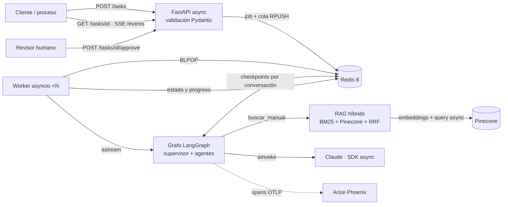
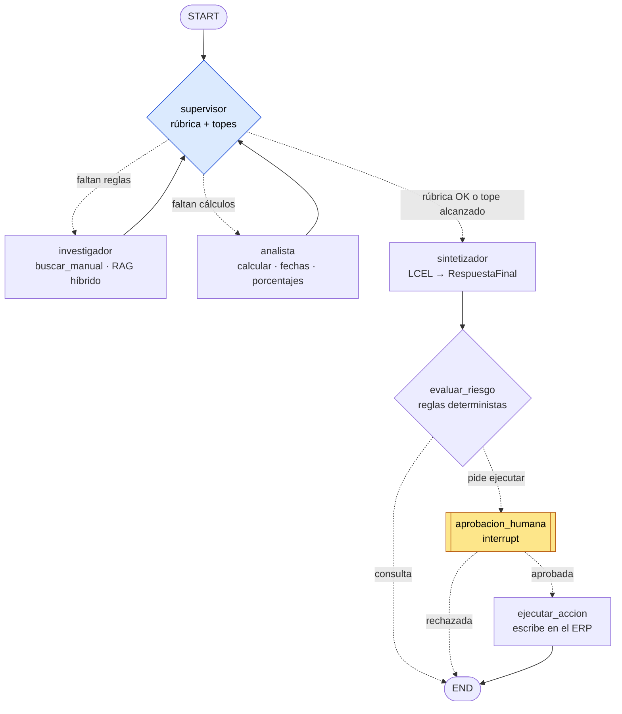
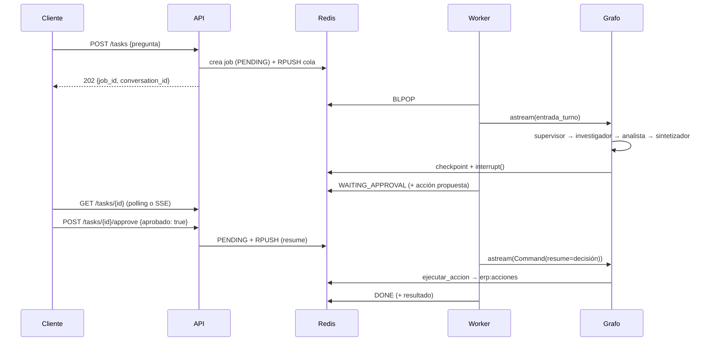

# OLA Muebles · ERP Intelligence System

Este sistema de IA responde consultas operativas sobre el ERP de OLA Muebles, una mueblería ficticia, y ejecuta acciones con aprobación humana. Una **API FastAPI asíncrona** encola cada pregunta. Un **worker** la resuelve con un **grafo de agentes (LangGraph)**: un **supervisor** delega en un **investigador**, que busca en el manual técnico con **RAG híbrido** (BM25 + Pinecone), y en un **analista**, que hace los cálculos con herramientas deterministas. Después valida los aportes y cierra con una respuesta estructurada.

Las conversaciones viven en **Redis**, con el checkpointer de LangGraph, y sobreviven a un reinicio del servidor. Si la tarea pide modificar el ERP, el grafo **se pausa hasta que una persona la apruebe**. Cada ejecución queda trazada en **Arize Phoenix**, con su árbol de spans, tokens, costo y latencia.

```bash
docker compose up --build        # o ./run.sh  ·  .\run.ps1 en Windows
```

> Los datos del ERP (el manual técnico y las reglas de negocio) son **ficticios**, creados para este proyecto.

---

## Qué resuelve

> **Usuario:** Hoy es 10/11/2026. Un cliente pidió el 28/10/2026 un presupuesto por una biblioteca a medida de $1.180.000 y quiere confirmarlo con un 18 % de descuento. ¿Sigue vigente? ¿Cuánto queda el precio y la seña? ¿Quién aprueba el descuento?

1. El **supervisor** ve que faltan reglas de negocio y delega en el **investigador**.
2. El **investigador** busca en el manual: un presupuesto vale 15 días corridos [03-api-ventas.md], los muebles a medida llevan una seña del 50 % [03-api-ventas.md] y los descuentos de más del 15 % los aprueba gerencia [02-autenticacion-y-roles.md].
3. El supervisor delega en el **analista**, que calcula con herramientas: 13 días transcurridos, vence el 12/11/2026, precio de $967.600 y seña de $483.800.
4. El supervisor aplica su **rúbrica** (cada regla con fuente, cada número calculado con herramientas, todo respondido) y el **sintetizador** devuelve la respuesta validada con Pydantic.
5. Si el usuario dice **"aplicá el descuento y registralo"**, el grafo se pausa en `WAITING_APPROVAL`. Solo ejecuta la acción después de `POST /tasks/{id}/approve`.
6. La pregunta siguiente en la misma conversación, por ejemplo "¿y si fuera el 20 %?", se responde con el contexto anterior, incluso después de reiniciar el servidor.

## Arquitectura



### El grafo de agentes



Las líneas punteadas son aristas condicionales. El supervisor devuelve un JSON validado (`DecisionSupervisor`) que se mapea al nombre del nodo con una función que devuelve un `Literal`.

### Una pregunta con aprobación humana



## De dónde sale cada pieza

Este repo **ensambla y refactoriza** lo construido a lo largo del programa de AI Engineering:

| Capa | Módulo de origen | Cómo quedó acá |
|---|---|---|
| Cliente LLM robusto | M1 · cliente asíncrono con reintentos | `app/core/llm.py`: SDK async oficial, reintentos con backoff, timeout y modelo por variable de entorno |
| Cadenas con contratos | M2 · LCEL + Pydantic | `app/agents/synthesizer.py`: `prompt \| llm.with_structured_output(RespuestaFinal)` con reintento y salida de respaldo en texto |
| Conocimiento | M3 y M4 · RAG local, luego Pinecone con búsqueda híbrida | `app/rag/`: chunking con metadatos, BM25 + Pinecone async, fusión RRF y prioridad de identificadores exactos. Es la herramienta del investigador |
| Razonamiento | M5 y M6 · agente ReAct y supervisor multi-agente | `app/agents/` + `app/graph/`: supervisor con rúbrica, criterio de suficiencia y topes contra bucles, especialistas con contexto acotado |
| Producción | M7 · FastAPI + Redis + Phoenix + HITL | `app/api/`, `app/services/`, `app/observability.py`, `app/graph/hitl.py` |
| **Nuevo en esta entrega** | — | Conversaciones multi-turno persistentes, SSE de progreso, ingesta automática del manual, Pydantic en todas las herramientas, configuración validada con `pydantic-settings` y degradación controlada |

## Estructura

```
app/
├── api/            main.py (fábrica + lifespan), routes.py (endpoints), schemas.py (contratos Pydantic)
├── core/           config.py (pydantic-settings), llm.py (fábrica de modelos), logging.py
├── rag/            documents.py (carga + chunking), vectorstore.py (Pinecone async),
│                   retriever.py (híbrido BM25 + vectorial + RRF), ingest.py (ingesta idempotente)
├── agents/         supervisor.py, research.py, analyst.py, synthesizer.py, tools.py, schemas.py
├── graph/          state.py (estado + reducer por turno), builder.py (grafo + checkpointer), hitl.py
├── services/       jobs.py (estado, cola, conversaciones y ERP en Redis), worker.py
└── observability.py  Phoenix / OpenTelemetry / OpenInference
data/manual/        manual técnico del ERP (8 archivos: Markdown, JSON y un PDF)
scripts/            pruebas_e2e.py (las 5 pruebas de punta a punta)
tests/              32 tests sin keys ni servicios externos
screenshots/        evidencia de trazas en Phoenix
```

## Decisiones de arquitectura

**1. Asíncrono de punta a punta.** Las llamadas a LLMs usan `ainvoke` sobre los SDK async de Anthropic y OpenAI (httpx). Pinecone usa `PineconeAsyncio` y `IndexAsyncio`, los embeddings `aembed_*` y Redis `redis.asyncio`. BM25 consume CPU y no hace I/O, así que corre en `asyncio.to_thread` para no frenar el event loop. No hay `requests` ni clientes síncronos en el código de la API.

**2. Cola y worker en lugar de esperar en el endpoint.** Una pregunta tarda entre 20 y 60 s. Si el endpoint esperara, se trabaría con pocas peticiones. `POST /tasks` responde 202 en milisegundos y N tareas asyncio consumen la cola de Redis. El worker puede correr aparte (`python -m app.services.worker`) para escalar sin cambiar la API.

**3. Redis para todo el estado.** Guarda los jobs, la cola, las conversaciones y los checkpoints de LangGraph (`AsyncRedisSaver`), con `appendonly` para persistir en disco. Hay un solo servicio que operar, y el estado sobrevive a reinicios de la API.

**4. Conversaciones con memoria y estado por turno.** El `thread_id` es la conversación. Los mensajes se acumulan entre preguntas, pero la pizarra de contribuciones se **reinicia en cada turno** con un reducer propio, `acumular` con el marcador `REINICIAR`: si no, el supervisor de la pregunta 2 evaluaría la pizarra de la pregunta 1. Los agentes reciben los últimos turnos como contexto (`HISTORIAL_TURNOS`). Solo se permite una pregunta activa por conversación, reservada con `WATCH/MULTI`, porque dos turnos simultáneos pisarían el mismo checkpoint.

**5. RAG híbrido con prioridad de identificadores.** BM25 encuentra términos literales y códigos, con stemming en español: "descuento" coincide con "descuentos", pero los códigos quedan intactos. La búsqueda vectorial encuentra paráfrasis. RRF las fusiona premiando el consenso. Cuando la consulta trae un código como `VTA-410-PRES`, los chunks que lo contienen van primero: en el Módulo 4 se midió que RRF podía relegar un chunk que BM25 ponía 1.º y la búsqueda vectorial no traía. Si Pinecone falla, el sistema **degrada a BM25** y lo registra, en lugar de caerse.

**6. Supervisor jerárquico con frenos que no dependen del modelo.** El supervisor valida con una rúbrica y un criterio de suficiencia estricto. Ese criterio surgió en el Módulo 6, porque un supervisor demasiado exigente también entra en bucle. Además tiene un tope de delegaciones (6), un tope de revisiones por especialista (2), una regla determinista si el JSON viene mal y el `recursion_limit` como techo duro. Los especialistas reciben **solo su encargo y los datos que necesitan**, sin el historial interno del sistema.

**7. Compuerta humana decidida por reglas.** Una compuerta de seguridad no puede depender de que el LLM la respete, así que se activa con verbos de acción en imperativo. Se pausa **después** del análisis, para que el humano decida con toda la información. Antes del `interrupt()` no hay efectos secundarios, porque al reanudar el nodo se vuelve a ejecutar.

**8. Contratos Pydantic en cada frontera.**
- **API:** entrada y salida de todos los endpoints.
- **Herramientas:** `args_schema` en cada una. Si el modelo manda un porcentaje de 150 o una fecha imposible, recibe el error y se corrige.
- **Salidas:** cada herramienta devuelve un modelo serializado.
- **Decisiones:** el supervisor devuelve `DecisionSupervisor` y el sintetizador `RespuestaFinal`.
- **Configuración:** `pydantic-settings`. Un valor inválido impide el arranque con un mensaje claro.

**9. Observabilidad que no ensucia.** Phoenix recibe por OTLP los spans de LangChain y LangGraph (OpenInference), más spans propios: `job.*` y `rag.busqueda_hibrida`. La sesión de Phoenix es la conversación. El proveedor de trazas **no se registra como global**, porque si no, la telemetría nativa de FastAPI trazaría cada `GET` del polling y llenaría el dashboard de ruido (lo vimos en el Módulo 7).

## API

Documentación interactiva en **http://localhost:8000/docs** (OpenAPI generado de los modelos Pydantic).

| Método | Ruta | Qué hace |
|---|---|---|
| `POST` | `/tasks` | Encola una pregunta (`{pregunta, conversation_id?}`) → `202 {job_id, conversation_id, links}` |
| `GET` | `/tasks/{job_id}` | Estado: `PENDING` · `RUNNING` · `WAITING_APPROVAL` · `DONE` · `FAILED`, más el resultado (respuesta, fuentes, recorrido, acción) |
| `GET` | `/tasks/{job_id}/events` | **SSE**: cada paso del grafo en vivo |
| `POST` | `/tasks/{job_id}/approve` | Decisión humana `{aprobado, revisor, comentario}` → reanuda el grafo desde el checkpoint |
| `POST` | `/conversations` | Crea una conversación vacía |
| `GET` | `/conversations/{id}` | Historial de la conversación, leído del checkpointer |
| `GET` | `/health` | Redis, modo de RAG, búsqueda vectorial activa y keys faltantes |

Errores: `404` si el job o la conversación no existe, `409` si se aprueba algo que no espera aprobación o si la conversación ya tiene una pregunta en curso, y `422` si la entrada es inválida.

## Cómo levantarlo

Requisitos: **Docker Desktop** y keys de Anthropic, OpenAI (embeddings) y Pinecone. Sin Pinecone ni OpenAI, el sistema funciona con `RAG_MODE=bm25`.

```bash
git clone https://github.com/fernandezulises66-svg/ola-erp-intelligence.git
cd ola-erp-intelligence
cp .env.example .env              # Windows: copy .env.example .env  → completá las keys
docker compose up --build         # o ./run.sh (Linux/Mac) · .\run.ps1 (Windows)
```

La primera vez, la API crea el índice de Pinecone si no existe y **sube el manual sola**. Después queda disponible en http://localhost:8000/docs, con Phoenix en http://localhost:6006.

**Sin Docker para la API** (con Python 3.12+; Redis y Phoenix siguen en Docker):

```bash
docker compose up -d redis phoenix
python -m venv .venv && source .venv/bin/activate     # Windows: .venv\Scripts\activate
pip install -r requirements-dev.txt
uvicorn app.api.main:app
```

### Las 5 pruebas de punta a punta

```bash
pip install httpx
python scripts/pruebas_e2e.py
```

| # | Pregunta | Qué demuestra |
|---|---|---|
| 1 | ¿Qué significa el error `VTA-410-PRES`? | RAG híbrido con prioridad de identificadores exactos |
| 2 | Vigencia, descuento, seña y rol aprobador | Razonamiento multi-paso: investigador → analista → síntesis |
| 3 | "¿Y si el descuento fuera del 20 %?" (misma conversación) | Memoria de conversación |
| 4 | Diferencia de caja de $7.300 | Multi-paso en otro módulo del manual |
| 5 | "Aplicá el descuento y registralo en el ERP" | Human-in-the-loop: pausa → aprobación → acción |

**Persistencia tras un reinicio:**

```bash
docker compose restart api
python scripts/pruebas_e2e.py --tras-reinicio    # retoma la conversación de la prueba 2
```

### Tests

```bash
pytest -v      # 32 tests, sin keys ni servicios: Redis falso, MemorySaver y modelos guionados
```

Cubren la API completa, la cola y el worker, el HITL (aprobación y rechazo), el paso a `FAILED`, 5 tareas concurrentes, la memoria entre turnos, la persistencia entre dos instancias de la app, el SSE, el RAG híbrido (fusión, identificadores exactos y degradación), la validación Pydantic de las herramientas, la compuerta de criticidad y la configuración inválida.

## Observabilidad

*Se completa con la corrida real: capturas en [`screenshots/`](./screenshots).*

## Configuración

Todo se configura por variables de entorno (ver [`.env.example`](./.env.example)). Estas son las principales:

| Variable | Default | Para qué |
|---|---|---|
| `ANTHROPIC_MODEL` | `claude-haiku-5-5` | Modelo de los agentes (`LLM_PROVIDER=openai` → `OPENAI_CHAT_MODEL`) |
| `RAG_MODE` | `hybrid` | `hybrid` (BM25 + Pinecone) o `bm25` |
| `PINECONE_INDEX_NAME` / `PINECONE_NAMESPACE` | `ola-erp-docs` / `intelligence-v1` | Índice y namespace (se crean y cargan solos) |
| `REDIS_URL` | `redis://localhost:6379/0` | Estado, cola y checkpoints |
| `WORKER_CONCURRENCY` | `5` | Preguntas en paralelo por proceso |
| `MAX_DELEGACIONES` / `RECURSION_LIMIT` | `6` / `40` | Frenos del grafo |
| `HISTORIAL_TURNOS` | `3` | Turnos previos que ve cada agente |
| `PHOENIX_COLLECTOR_ENDPOINT` | `http://localhost:6006/v1/traces` | Destino de las trazas |

## Límites conocidos y próximos pasos

- **Latencia:** cada búsqueda en Pinecone tarda unos 3,5 s (embedding más consulta). El próximo paso sería cachear embeddings y resultados de consultas repetidas.
- **Detección de acciones críticas:** se basa en verbos en imperativo. Una frase como "necesito que se registre…" no la activa. Se podría sumar un clasificador como segunda capa, sin quitar las reglas.
- **"ERP" simulado:** las acciones aprobadas se escriben en una lista de Redis. En producción, `ejecutar_accion` llamaría a la API real del ERP con idempotencia.
- **Autenticación:** la API y Phoenix no tienen autenticación porque el alcance es despliegue local. En producción irían API keys o OAuth en la API y `PHOENIX_ENABLE_AUTH=true`.
